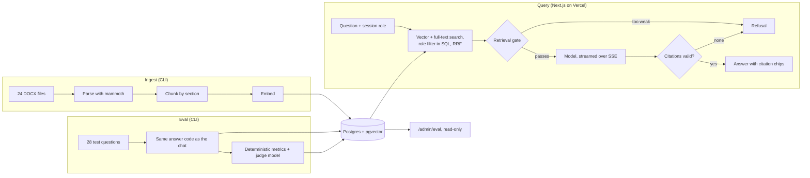
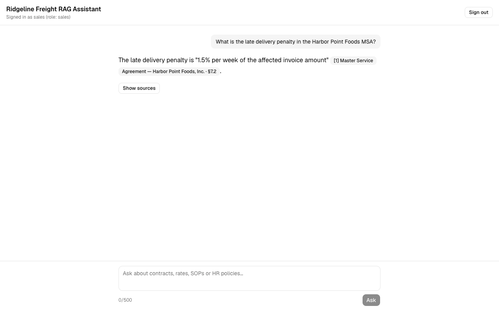
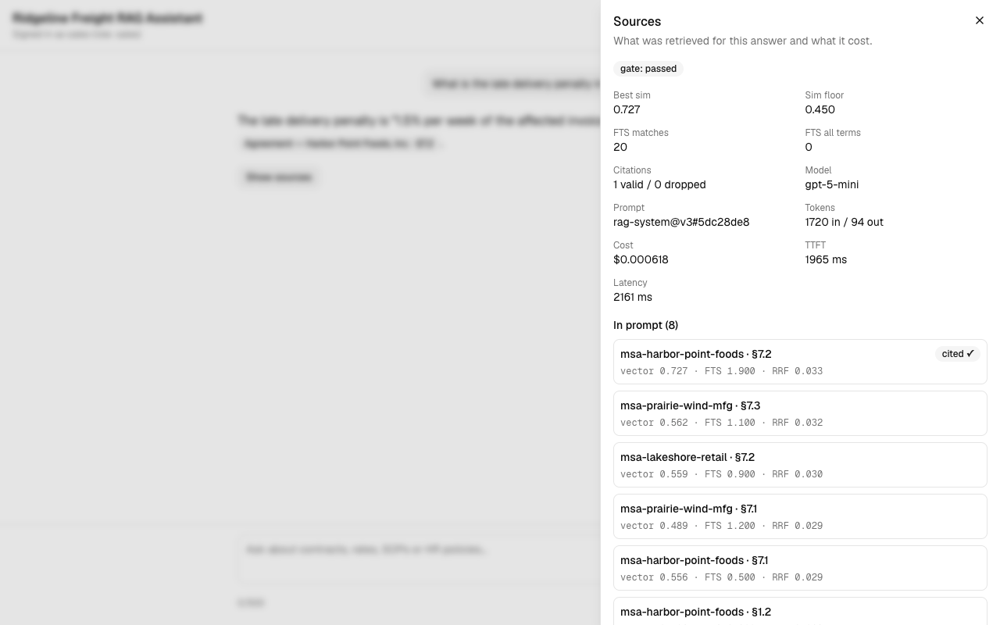

# Ridgeline Freight RAG Assistant

[](https://github.com/rarpavel/ridgeline-freight/actions/workflows/ci.yml)

A document assistant for a fictional US freight company. It answers from 24 synthetic contracts, rate sheets, SOPs and HR policies with citations you can click, refuses when the documents don't hold the answer, enforces roles in the SQL query, and is measured on a held-out question set. [Live demo](https://ridgeline-freight.vercel.app) · [Evaluation method](docs/04-ai/EVALUATION.md) · [Specification](docs/SPEC.md)

## Results

Test split, 28 held-out questions, run on the production data on 2026-11-03. Model `gpt-5-mini`, prompt `rag-system@v3`, dataset `2026.11-2`, judge `claude-haiku-5-5`, run `98810a54`.

| Metric | Value | Target |
|--------|-------|--------|
| Retrieval hit rate (document level) | 1.000 | ≥ 0.90 |
| Correctness (judge) | **0.824, missed** | ≥ 0.85 |
| Faithfulness (judge) | 1.000 | ≥ 0.90 |
| Refusal accuracy | 1.000 | ≥ 0.95 |
| Cross-role leaks | 0 | 0 |
| False refusal rate | 0.056 | ≤ 0.10 |
| Time to first token, p50 | **3,268 ms, missed** | < 3,000 ms |
| Cost per question | $0.00069 | none |

- **Correctness missed:** 14 of 17 answers scored 1. One lost a fact that never reached the prompt, and two answered a yes/no question correctly but left out a value the reference states.
- **Time to first token missed:** it rises with the model's hidden reasoning, and the run was measured from a developer laptop rather than from Vercel.

Nothing was tuned after this run. The per-question reasons are in [EVALUATION.md §3](docs/04-ai/EVALUATION.md#3-targets-test-split).

## Architecture



Next.js 16 (App Router, TypeScript strict), Postgres with pgvector, Drizzle ORM, any OpenAI-compatible model client, `iron-session`, Vercel and Neon, GitHub Actions. More in [ARCHITECTURE.md](docs/02-architecture/ARCHITECTURE.md).

## Demo

https://ridgeline-freight.vercel.app. Sign in at [/login](https://ridgeline-freight.vercel.app/login) as `sales`, `hr`, `ops` or `admin`. The passwords are on that page, because these are public demo accounts and all the data is synthetic.

| Role | Try asking |
|------|-----------|
| `sales` | What is the late delivery penalty in the Harbor Point Foods MSA? |
| | How does Northline Auto Parts' per-shipment liability limit compare with Marlowe & Finch's? |
| | How many PTO days do drivers accrue per month? (refused: an HR document) |
| `hr` | How many paid holidays does Ridgeline observe each year? |
| | How many paid sick days accrue per year? |
| | What is the late delivery penalty in the Harbor Point Foods MSA? (refused: a sales document) |
| `ops` | How quickly do we need to pay Granite Fork Intermodal once it sends an invoice? |
| | Does the $250,000 cargo cap in the Juniper Bend agreement apply to a load on container chassis? |
| | What is the CEO's salary? (refused: not in any document) |
| `admin` | How much do drivers earn per hour for detention once free time has run out? |
| | What are the payment terms for Harbor Point Foods compared with Lakeshore Retail Group? |
| | What is the CEO's salary? (refused: not in any document) |

An admin can also open [/admin/eval](https://ridgeline-freight.vercel.app/admin/eval) for every run and every question.

## What it does





- **Citations you can check:** every claim carries a numbered citation, and one click opens the document with the passage highlighted.
- **Refuses instead of guessing:** enforced by a retrieval gate, a model refusal and citation validation, not only by the prompt. An answer with no valid citation becomes a refusal.
- **Roles in the database:** `sales`, `hr`, `ops` and `admin` are filtered in every SQL query, and a test runs every role against every eval question.
- **Shows its work:** Show sources lists the retrieved passages, scores, cost and latency of the request.
- **Measured:** a held-out test set, scored by deterministic metrics and by an independent judge model.

## Evaluation

Questions are generated by a different model than the documents, must paraphrase them, and are split into `dev` for tuning and `test` for reporting. The CLI uses the same answer code as the chat.

```bash
pnpm eval --split test --label my-run
```

Add `--no-judge` for deterministic metrics only, without an Anthropic key. A full run costs about $0.10. Method, metrics and rubric: [EVALUATION.md](docs/04-ai/EVALUATION.md).

## Run locally

Requires Node 22 or newer, pnpm and Docker with Compose.

```bash
pnpm i
docker compose up -d
cp .env.example .env.local
```

Postgres listens on port 5432. If that port is taken, put `POSTGRES_PORT=<port>` in `.env` before `docker compose up -d` (Compose does not read `.env.local`) and use the same port in the database URLs in `.env.local`.

Fill in the empty required values in `.env.local` (`OPENAI_API_KEY`, `SESSION_SECRET`, `DEMO_ACCOUNTS_JSON`); the app refuses to start without them and names what is missing. `openssl rand -base64 48` gives a `SESSION_SECRET`. `pnpm hash-password` prints a ready `DEMO_ACCOUNTS_JSON` line for `.env.local`, with random passwords and every `$` escaped as `\$`. Then:

```bash
pnpm db:migrate
pnpm ingest
pnpm dev
```

`pnpm ingest` indexes the 24 documents in `data/corpus` (embeddings cost well under $0.01). A repeat run skips unchanged documents; `--force` rewrites them and `--only <slug>` limits the run to one document.

Open http://localhost:3000/login. The session cookie is always `Secure`; Chrome and Firefox accept that on `localhost`, but Safari may not, so use one of those to sign in locally.

Checks: `pnpm typecheck`, `pnpm lint`, `pnpm test`, and `pnpm test:integration` with the database running.

## Security and cost guardrails

- Role filter in SQL on every chunk and document query, with a leak test in CI.
- Auth checked in `proxy.ts` and again in each handler.
- Rate limits per account and per IP, and a daily token budget, stored in Postgres.
- Limits on question length and answer length.
- Model output is sanitized before rendering, and instructions embedded in documents are ignored.
- Security headers, and secrets only through a validated `src/env.ts`.

Details: [SECURITY.md](docs/06-ops/SECURITY.md).

## Limitations

- A synthetic corpus of 24 DOCX documents, in English only.
- Single-turn questions, with no history and no document upload.
- Demo-scale rate limits.
- Only 8 passages reach the prompt, at most 3 per document. A fact can be retrieved and still miss the prompt, and questions that span many documents get partial answers. The retrieval hit rate counts documents, so it does not show this.
- One judge model with a small manual check, and its rubric is strict about reference values it can read unevenly.

## Roadmap

Not built: local model support, OCR and PDF parsing, a CI evaluation gate, a prompt-injection test corpus, conversation history, a reranker, document upload, multi-tenancy. See [SPEC.md §13](docs/SPEC.md).

## Project docs

- Product: [PRD](docs/01-product/PRD.md), [specification](docs/SPEC.md)
- Architecture: [overview](docs/02-architecture/ARCHITECTURE.md), [decision records](docs/02-architecture/adr/)
- Data: [data model](docs/03-data/DATA_MODEL.md), [synthetic data](docs/03-data/SYNTHETIC_DATA.md)
- AI: [RAG pipeline](docs/04-ai/RAG_PIPELINE.md), [prompts](docs/04-ai/PROMPTS.md), [evaluation](docs/04-ai/EVALUATION.md)
- Engineering: [conventions](docs/05-engineering/CONVENTIONS.md), [testing](docs/05-engineering/TESTING.md), [workflow](docs/05-engineering/WORKFLOW.md)
- Operations: [security](docs/06-ops/SECURITY.md), [deployment](docs/06-ops/DEPLOYMENT.md), [observability](docs/06-ops/OBSERVABILITY.md)

## Milestones

- **M0, 2026-11-02:** the app runs in production on Vercel and Neon with sign-in for four demo accounts, a health check and CI.
- **M1, 2026-11-02:** the data is ready: 24 synthetic DOCX documents pass validation, and 40 reviewed eval questions are split into dev 12 and test 28 (`data/VERSION` 2026.11-1).
- **M2, 2026-11-03:** production answers questions from the indexed corpus (24 documents, 423 chunks) with streamed text and citation chips, checked with one question for each of the four roles.
- **M3, 2026-11-03:** production refuses what the documents the role can read do not answer (`SIM_FLOOR` 0.45, calibrated on the dev split), a citation opens the document viewer with the passage highlighted, and Show sources reads the request trace. Checked for each of the four roles, with no other role's document among the candidates of the `sales`, `hr` and `ops` requests.

## License

MIT — see [LICENSE](LICENSE). The corpus is synthetic; company, customer and carrier names are fictional and any resemblance to real businesses is coincidental.
