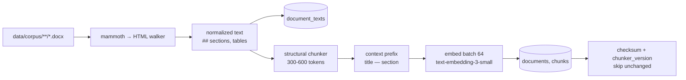
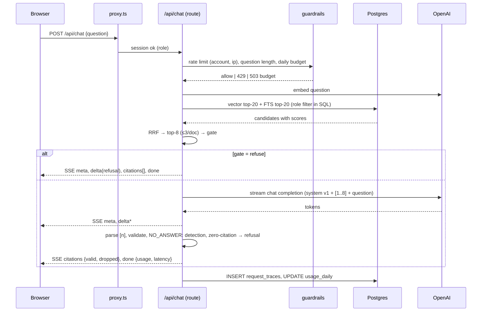

# Architecture

Components, data flows, runtime boundaries and failure handling of the Ridgeline Freight RAG assistant (MVP scope, `docs/SPEC.md` v3). Decisions with alternatives are recorded in `docs/02-architecture/adr/`.

Last updated: 2026-11-02

## 1. Components

| Component | Runtime | Responsibility |
|-----------|---------|----------------|
| Web app (`src/app`) | Vercel Functions (Node.js, Fluid compute) + static assets | Login, chat UI, streaming chat API, document viewer, admin eval page, health |
| RAG core (`src/server/rag`) | Shared library, imported by the web app and the CLIs | Retrieval (hybrid), fusion, gate, prompt assembly, generation, citation validation, trace |
| Ingest CLI (`scripts/ingest.ts`) | Developer machine | Parse DOCX → chunk → embed → upsert into Postgres |
| Data-gen CLI (`scripts/data-gen/*`) | Developer machine | World bible → registry → documents → DOCX → validation → eval questions |
| Eval CLI (`scripts/eval.ts`) | Developer machine | Runs questions through the RAG core, computes metrics, calls the judge, writes `eval_runs` |
| Postgres + pgvector | Neon (prod), Docker (local, CI) | Documents, chunks with embeddings, traces, eval, rate limits |
| LLM providers | OpenAI (chat + embeddings), Anthropic (judge, CLI only) | Completion, embeddings, judging |

Rule: **nothing long-running or expensive runs inside a Vercel function** except one chat completion per request. Ingestion and evaluation are CLIs.

## 2. Data flows

### 2.1 Ingestion



### 2.2 Chat request



Streaming protocol (SSE), events in order:

| Event | Payload | Notes |
|-------|---------|-------|
| `meta` | `{ traceId, promptVersion, model, gate: "answer" \| "refuse" }` | first |
| `delta` | `{ text }` | zero or more |
| `citations` | `{ valid: [{ n, chunkId, documentId, title, sectionRef }], dropped: [n] }` | once, after the last delta |
| `done` | `{ refused, usage: { inputTokens, outputTokens }, ttftMs, latencyMs, costUsd }` | last on success |
| `error` | `{ code: "rate_limited" \| "budget_exhausted" \| "llm_error" \| "db_error", message }` | terminal |

The client renders `[n]` markers as plain text while streaming and upgrades them to chips on `citations`; dropped markers are removed.

### 2.3 Document viewer

`GET /api/documents/:id?chunk=:chunkId` → checks `access_roles && session.roles` → returns `document_texts.text`, `sections` and the chunk's `char_start/char_end`. The page renders the text and scrolls to the highlighted range. `GET /api/documents/:id/original` serves the DOCX with the same check.

### 2.4 Evaluation

```mermaid
flowchart LR
  Q[(eval_questions\nsplit=test)] --> E[eval CLI]
  E --> C[RAG core\nsame code as /api/chat]
  C --> M1[deterministic metrics\nhit rate, leaks, refusal, latency, cost]
  C --> J[judge: claude-haiku-5-5\ncorrectness, faithfulness]
  M1 --> R[(eval_runs, eval_results)]
  J --> R
  R --> UI[/admin/eval]
```

## 3. Runtime boundaries

| Concern | Where | Why |
|---------|-------|-----|
| Auth check | `proxy.ts` (redirect) **and** each route/server function (`requireSession()`) | Proxy can be bypassed by matcher changes; Next.js docs say so |
| Role filter | SQL `WHERE access_roles && $1` in every chunk/document query | Never in the prompt |
| Secrets | server env only; `src/env.ts` validates at boot | No client bundles with keys |
| Long jobs | CLIs on the developer machine | Vercel 300 s limit, cost control |
| Pricing | `config/pricing.json` with `asOf` | Cost shown in traces |

## 4. Failure scenarios

| Failure | Behavior | User sees |
|---------|----------|-----------|
| DB unreachable / Neon cold start | Query timeout 8 s; retry once on connection error | "The document store is waking up, retry in a few seconds" |
| LLM error / timeout (30 s) | Abort stream, trace with `error` | "The model is unavailable, please retry" |
| Embedding error on query | FTS-only retrieval, flagged in trace | Normal answer; trace shows `vectorUnavailable` |
| Rate limit exceeded | 429 before any model call | Countdown message |
| Daily budget exhausted | 503 before any model call | "Demo budget for today is spent" banner |
| Model cites unknown `[n]` | Dropped, logged, counted | Chip missing; text unchanged |
| Model answers with no valid citations | Converted to refusal | Refusal message |
| Ingestion crash mid-document | Transaction per document | — |
| Eval run crash | `finished_at` null; `--resume <runId>` | Admin page shows "incomplete" |

## 5. Environments

Local (`pnpm dev` + Docker Postgres) and production (Vercel + Neon). Details in `docs/06-ops/DEPLOYMENT.md`.
