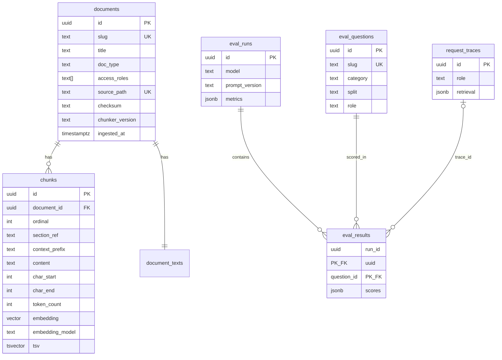

# Data Model

Final Postgres schema, indexes, constraints, migration and seed strategy. Drizzle schema files in `src/server/db/schema/*.ts` must match this document; the SQL here is the source of truth for review.

Last updated: 2026-11-02

## 1. ER diagram



## 2. Schema (SQL)

```sql
CREATE EXTENSION IF NOT EXISTS vector;

CREATE TABLE documents (
  id               uuid PRIMARY KEY DEFAULT gen_random_uuid(),
  slug             text NOT NULL UNIQUE,                       -- 'msa-harbor-point-foods'
  title            text NOT NULL,
  doc_type         text NOT NULL CHECK (doc_type IN ('msa','carrier_agreement','hr_policy','sop','rate_sheet')),
  access_roles     text[] NOT NULL CHECK (cardinality(access_roles) > 0
                                           AND access_roles <@ ARRAY['sales','hr','ops','admin']),
  source_path      text NOT NULL UNIQUE,                       -- data/corpus/msa/harbor-point-foods.docx
  checksum         text NOT NULL,                              -- sha256 of file bytes
  effective_date   date,
  chunker_version  text NOT NULL,                              -- 'v1'
  ingested_at      timestamptz NOT NULL DEFAULT now()
);

CREATE TABLE document_texts (
  document_id      uuid PRIMARY KEY REFERENCES documents(id) ON DELETE CASCADE,
  text             text NOT NULL,          -- normalized text with '## 4. Service Levels' / '### 4.3 Late Delivery' headings
  sections         jsonb NOT NULL          -- [{ref:'4.3', title:'Late Delivery Penalties', charStart, charEnd}]
);

CREATE TABLE chunks (
  id               uuid PRIMARY KEY DEFAULT gen_random_uuid(),
  document_id      uuid NOT NULL REFERENCES documents(id) ON DELETE CASCADE,
  ordinal          int  NOT NULL,
  section_ref      text,                                       -- '4.3'
  section_title    text,                                       -- 'Late Delivery Penalties'
  context_prefix   text NOT NULL,                              -- 'Harbor Point Foods MSA — 4. Service Levels › 4.3 Late Delivery Penalties'
  content          text NOT NULL,
  char_start       int  NOT NULL,                              -- offsets into document_texts.text
  char_end         int  NOT NULL,
  token_count      int  NOT NULL,
  embedding        vector(1536) NOT NULL,
  embedding_model  text NOT NULL,                              -- 'text-embedding-3-small'
  tsv              tsvector GENERATED ALWAYS AS
                     (to_tsvector('english', coalesce(context_prefix,'') || ' ' || content)) STORED,
  UNIQUE (document_id, ordinal),
  CHECK (char_end > char_start),
  CHECK (token_count > 0)
);
CREATE INDEX chunks_document_idx ON chunks (document_id);
CREATE INDEX chunks_tsv_idx      ON chunks USING gin (tsv);
-- No vector index on purpose: ~700 rows, exact cosine scan is a few milliseconds and has
-- no filtered-recall problem. Add HNSW (pgvector >= 0.8 with iterative scans) if the corpus grows 50x.

CREATE TABLE eval_questions (
  id               uuid PRIMARY KEY DEFAULT gen_random_uuid(),
  slug             text NOT NULL UNIQUE,                       -- 'direct-012'
  category         text NOT NULL CHECK (category IN ('direct','comparison','exception','no_answer','other_role')),
  split            text NOT NULL CHECK (split IN ('dev','test')),
  role             text NOT NULL CHECK (role IN ('sales','hr','ops','admin')),
  question         text NOT NULL,
  expected_answer  text,                                       -- NULL = must refuse
  expected_doc_slugs   text[] NOT NULL DEFAULT '{}',           -- resolved to ids at eval time
  source_fact_ids      text[] NOT NULL DEFAULT '{}',
  distractor_doc_slugs text[] NOT NULL DEFAULT '{}',
  reviewed         boolean NOT NULL DEFAULT false,
  notes            text,
  dataset_version  text NOT NULL
);

CREATE TABLE eval_runs (
  id               uuid PRIMARY KEY DEFAULT gen_random_uuid(),
  label            text,
  split            text NOT NULL CHECK (split IN ('dev','test','all')),
  model            text NOT NULL,                              -- chat model id
  embedding_model  text NOT NULL,
  judge_model      text,
  prompt_version   text NOT NULL,                              -- 'rag-system@v1#a1b2c3d4'
  retrieval_config jsonb NOT NULL,                             -- {k:60, vectorTopK:20, ftsTopK:20, finalK:8, perDocCap:3, simFloor:0.30}
  git_sha          text NOT NULL,
  dataset_version  text NOT NULL,
  started_at       timestamptz NOT NULL DEFAULT now(),
  finished_at      timestamptz,
  metrics          jsonb                                       -- aggregates, see EVALUATION.md
);

CREATE TABLE eval_results (
  run_id           uuid NOT NULL REFERENCES eval_runs(id) ON DELETE CASCADE,
  question_id      uuid NOT NULL REFERENCES eval_questions(id) ON DELETE CASCADE,
  answer           text NOT NULL,
  refused          boolean NOT NULL,
  cited_chunk_ids  uuid[] NOT NULL DEFAULT '{}',
  retrieved        jsonb NOT NULL,                             -- [{chunkId, documentId, vectorRank, vectorSim, ftsRank, ftsScore, rrf, inPrompt}]
  scores           jsonb NOT NULL,                             -- {retrievalHit, correctness, faithfulness, refusalCorrect, leak}
  judge_rationale  text,
  ttft_ms          int,
  latency_ms       int NOT NULL,
  cost_usd         numeric(10,6),
  trace_id         uuid,
  PRIMARY KEY (run_id, question_id)
);

CREATE TABLE request_traces (
  id               uuid PRIMARY KEY DEFAULT gen_random_uuid(),
  created_at       timestamptz NOT NULL DEFAULT now(),
  source           text NOT NULL CHECK (source IN ('chat','eval')),
  account          text NOT NULL,                              -- demo account id
  role             text NOT NULL,
  question         text NOT NULL,
  embedding_model  text,
  retrieval        jsonb NOT NULL,                             -- same shape as eval_results.retrieved + bestSim, ftsMatches
  gate             text NOT NULL CHECK (gate IN ('answer','refuse_gate')),
  prompt_version   text,
  model            text,
  input_tokens     int,
  output_tokens    int,
  cost_usd         numeric(10,6),
  ttft_ms          int,
  latency_ms       int,
  refused          boolean NOT NULL DEFAULT false,
  citations_valid  int NOT NULL DEFAULT 0,
  citations_dropped int NOT NULL DEFAULT 0,
  error            text
);
CREATE INDEX request_traces_created_idx ON request_traces (created_at DESC);

CREATE TABLE rate_limits (
  key              text NOT NULL,                              -- 'acct:sales' | 'ip:<sha256 of ip>'
  window_start     timestamptz NOT NULL,                       -- date_trunc('hour', now())
  count            int NOT NULL DEFAULT 0,
  PRIMARY KEY (key, window_start)
);

CREATE TABLE usage_daily (
  day              date PRIMARY KEY,
  requests         int NOT NULL DEFAULT 0,
  input_tokens     bigint NOT NULL DEFAULT 0,
  output_tokens    bigint NOT NULL DEFAULT 0,
  cost_usd         numeric(10,4) NOT NULL DEFAULT 0
);
```

Notes:
- `tsv` covers `context_prefix || content` so document titles and section names are searchable.
- `embedding_model` is recorded so a future re-embed with another model is detectable; the dimension is fixed at 1536 for the MVP.
- `access_roles <@ ARRAY[...]` rejects typos at insert time.
- No `users` table; demo accounts live in env (ADR-0006).

## 3. Query patterns

Retrieval (two statements in one transaction):

```sql
-- vector candidates (exact scan)
SELECT c.id, c.document_id, 1 - (c.embedding <=> $1::vector) AS sim
FROM chunks c JOIN documents d ON d.id = c.document_id
WHERE d.access_roles && $2::text[]
ORDER BY c.embedding <=> $1::vector LIMIT 20;

-- fts candidates
SELECT c.id, c.document_id, ts_rank_cd(c.tsv, q) AS score
FROM chunks c JOIN documents d ON d.id = c.document_id, websearch_to_tsquery('english', $3) q
WHERE c.tsv @@ q AND d.access_roles && $2::text[]
ORDER BY score DESC LIMIT 20;
```

Rate limit (one statement):

```sql
INSERT INTO rate_limits (key, window_start, count) VALUES ($1, date_trunc('hour', now()), 1)
ON CONFLICT (key, window_start) DO UPDATE SET count = rate_limits.count + 1
RETURNING count;
```

Daily budget: `INSERT INTO usage_daily (day) VALUES (current_date) ON CONFLICT DO NOTHING; SELECT input_tokens + output_tokens FROM usage_daily WHERE day = current_date;` before the model call; `UPDATE … SET` after it.

## 4. Migration strategy

- Tool: drizzle-kit, SQL files in `drizzle/` (ADR-0003). `pnpm db:generate` after schema edits, `pnpm db:migrate` applies with `DATABASE_URL_DIRECT`.
- Custom migrations (`drizzle-kit generate --custom`) hold the extension, the generated `tsv` column and CHECK constraints Drizzle cannot express.
- `drizzle.config.ts` loads `.env.local` when it exists, with variables already set taking precedence, and uses `DATABASE_URL_DIRECT`, falling back to `DATABASE_URL`.
- Migration files so far:

| File | Kind | Contents |
|------|------|----------|
| `0000_enable_pgvector.sql` | custom | `CREATE EXTENSION vector`, before any table uses the type |
| `0001_corpus_tables.sql` | generated | `documents`, `document_texts`, `chunks`, their foreign keys, unique constraints and `chunks_document_idx` |
| `0002_corpus_constraints_and_tsv.sql` | custom | CHECK constraints on `doc_type`, `access_roles`, `char_end > char_start` and `token_count > 0`; generated `tsv`; `chunks_tsv_idx` |

- `chunks.tsv` and the CHECK constraints are not declared in `src/server/db/schema/*.ts`, so Drizzle never tries to write `tsv`; queries reach it through `sql`. `tests/integration/migrations.test.ts` fails if the database columns and the Drizzle schema diverge.
- Forward-only; a rollback is a new migration. CI applies all migrations to a fresh `pgvector/pgvector:pg17` container on every PR. Production migrations are run from the developer's machine before merging the PR that needs them (`DEPLOYMENT.md §3`); migrations are additive so the previous app version keeps working.

## 5. Seed strategy

| Data | Source | Command | Idempotent by |
|------|--------|---------|---------------|
| documents, document_texts, chunks | `data/corpus/**/*.docx` | `pnpm ingest` | `checksum` + `chunker_version` |
| eval_questions | `data/eval/questions.json` | `pnpm eval:import` | `slug` (upsert) |
| demo accounts | env `DEMO_ACCOUNTS_JSON` | — | — |
| pricing | `config/pricing.json` | — | — |

A fresh environment is: `pnpm db:migrate && pnpm ingest && pnpm eval:import`.

## 6. Changing the embedding model (not planned for the MVP)

`pnpm ingest --force` re-embeds everything with the model in `EMBEDDING_MODEL` and writes `embedding_model`; a model with a different dimension needs a migration that changes `vector(1536)` first. Mixed models in one table are rejected by a startup check (`SELECT DISTINCT embedding_model`).

## 7. Sizing

24 documents × ~2–3 pages → ~500–800 chunks; 1,536 floats × 4 bytes ≈ 6 KB per chunk → ~5 MB. `request_traces` grows ~5 KB per request. Neon Free (1 GB) is far from any limit.
